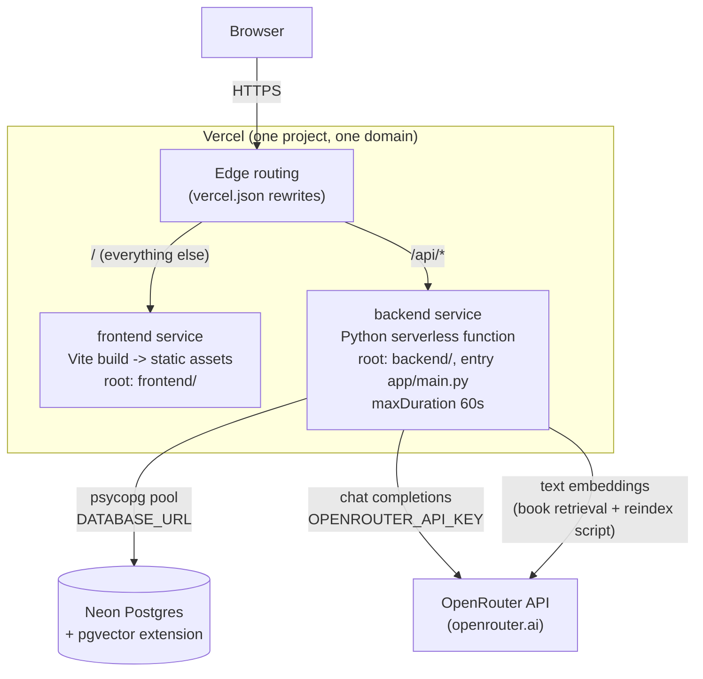
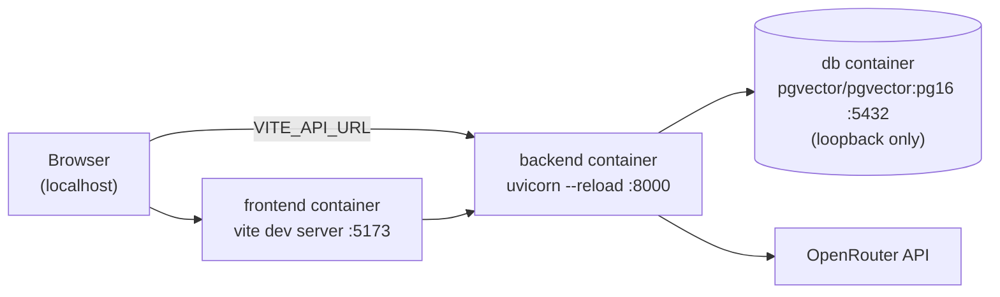

# itm-tutor

Adaptive tutoring prototype: a deterministic rules/planner control layer in
front of an LLM tutor, with a book-grounded RAG layer over one course
textbook. See [claude.md](claude.md) for the full spec, [backend/README.md](backend/README.md)
for backend setup, and [frontend/README.md](frontend/README.md) for frontend setup.

The backend is a stateless FastAPI app by design (see [vercel.json](vercel.json)
and [backend/vercel.json](backend/vercel.json)). It does no local disk writes
at request time and keeps no in-process cache that must survive between
requests, so it runs the same way on a serverless function or a long-lived
container.

## How adaptation works

A profile collected **once, before instruction**, is mapped to a control vector
by a pure rule set ([backend/app/core/mapping.py](backend/app/core/mapping.py),
[backend/rules/ruleset.v1.yaml](backend/rules/ruleset.v1.yaml)); the vector
selects fixed prompt clauses for the LLM tutor. Everything the learner sees
(profile, fired rules, vector) can be overridden per field before instruction.

**Onboarding** collects four *mapping inputs* -- prior-knowledge seed
(`none/low/moderate/high`), learning goal (`certification/applied/orientation`),
retention horizon (`within_2_weeks/1_to_3_months/long_term`) and industry -- plus three *preferences*.

**Two-layer prior knowledge.** The onboarding answer is only a *seed*. Before
the first lesson of a chapter that has a diagnostic, the learner answers a
4-item rapid diagnostic after Kalyuga & Sweller (2004) -- recognition,
classification, first step, transfer; each with an "I don't know" option that
scores 0. A fixed lookup table `(correct_count, seed) -> level` gives a
chapter-level prior knowledge that **replaces the seed for that chapter's
mapping call only**; the seed itself is never updated. A summary screen shows
the result and the chapter's vector with per-field override. The diagnostics
are drafted offline (`make diagnostics` in `backend/`, or written directly from the chapter text), reviewed by a human
and committed as static YAML under `backend/content/diagnostics/`, next to the
shared `scoring_table.yaml`; the server only loads them, and refuses to start
on an invalid file. A chapter without a file has no diagnostic and uses the seed.

**Preferences are not in the mapping.** `simplified_language` (on/off),
`presentation_style` (`concise/balanced/verbose`) and `learner_type` (Lerntyp
nach Vester: visuell/auditiv/kommunikativ/motorisch/none) never reach
`derive()`; they only add fixed sentences to the assembled prompt.

**Design invariants** (details and enforcing tests in [claude.md](claude.md)):

- **DR1** -- no in-session performance signal feeds the profile or the vector.
  The diagnostic runs before instruction; answers during instruction are never read back.
- **DR2** -- `derive()` is pure, total and deterministic; it never reads the clock.
- **DR4** -- help on request within a turn stays with the LLM.
- **DR6** -- the profile and the resulting vector are visible and overridable before instruction.

## Production deployment

One Vercel project, defined by the root [vercel.json](vercel.json), builds and
routes two services on a single domain:



| Piece | Runs where | Notes |
|---|---|---|
| Frontend | Vercel, static hosting | [im-tutor-smoky.vercel.app](https://im-tutor-smoky.vercel.app/). Built from `frontend/` with Vite (`npm run build` produces `dist/`). No server-side code. |
| Backend API | Vercel, Python serverless function | [backend-red-eight-q9sab1t0oo.vercel.app](https://backend-red-eight-q9sab1t0oo.vercel.app/). `backend/`, entry point `app/main.py`. Vercel's Python runtime installs from `requirements.txt` (regenerated from `pyproject.toml`/`uv.lock`, see [backend/README.md](backend/README.md)), not `uv sync` directly. |
| Database | Neon, managed Postgres external to Vercel | Host: `ep-squar-bonus-axiy6u3k-pooler.c-4.us-east-2.aws.neon.tech`. Stores everything the app needs to persist: users, conversations/messages, attachments (as `BYTEA`), lesson plans, turn logs, rate-limit counters, and the book's embedded chunks (`book_chunks`, via the `pgvector` extension). Reached over `DATABASE_URL`. |
| LLM + embeddings | OpenRouter, external API | One API key (`OPENROUTER_API_KEY`) covers both chat completions (`app/llm/client.py`, model via `OPENROUTER_MODEL`) and text embeddings (`app/rag/embeddings.py`, model via `OPENROUTER_EMBEDDING_MODEL`). No local ML models, so nothing torch-sized ships in the function. |
| Course PDF + extracted figures | Bundled into the backend deployment | `backend/Krcmar2015_Informationsmanagement.pdf` and the images under `backend/data/book_images/` are static, read-only files shipped with the function (produced once by `scripts/extract_book_images.py`), not written at request time. |

Routing: the root [vercel.json](vercel.json) rewrites `/api/*` to the backend
service and everything else to the frontend service, so both are served from
the same domain and the frontend can call the API same-origin in production.

Health: `GET /api/health` returns `{"status": "ok", "database": "ok"}` (HTTP
200) when the database is reachable, or `{"status": "degraded", "database":
"error: ..."}` (HTTP 503) when it is not. The backend also boots even if the
database is unreachable at cold start (Neon compute asleep, bad
`DATABASE_URL`) instead of dark-404ing every route -- schema creation retries
on the first request that reaches the database.

## Local development

`docker-compose.yml` runs the same three roles as separate containers instead
of Vercel + Neon:



```
docker compose up
```

- `db`: `pgvector/pgvector:pg16` (plain `postgres` lacks the `vector`
  extension `book_chunks` needs), bound to `127.0.0.1` only.
- `backend`: built from `backend/Dockerfile`, reads config from
  `backend/.env` (copy `backend/.env.example`); `DATABASE_URL` is overridden
  to point at the `db` service.
- `frontend`: built from `frontend/Dockerfile`, Vite dev server with HMR.

## Required secrets/config

From `backend/.env.example`:

| Variable | Purpose |
|---|---|
| `OPENROUTER_API_KEY` | Auth for both chat completions and embeddings |
| `OPENROUTER_MODEL` | Chat model, e.g. `openai/gpt-4o-mini` |
| `OPENROUTER_EMBEDDING_MODEL` | Embedding model, e.g. `openai/text-embedding-3-small` (must match `book_chunks.embedding`'s dimensions in `app/store/db.py`) |
| `DATABASE_URL` | Postgres connection string (Neon in production, `db` service locally) |
| `FRONTEND_ORIGIN` | Comma-separated allowed CORS origins |
| `AUTH_SECRET` | HS256 signing secret for login tokens |
| `SUPERUSER_USERNAME` / `SUPERUSER_PASSWORD` | Seeded as an approved admin on first startup only |

Frontend: `VITE_API_URL` (see `frontend/src/api/client.ts`) is the backend
base URL. Unset locally, it defaults to `http://localhost:8000`.
