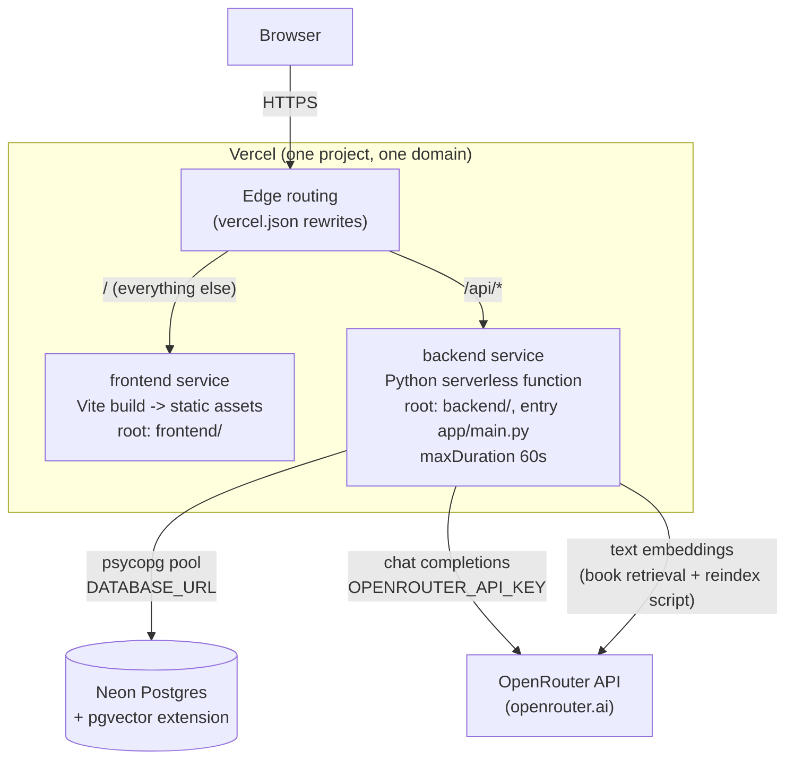
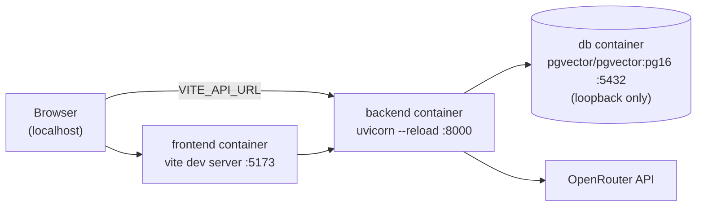

# itm-tutor

An adaptive tutoring web app for one course textbook (Krcmar, *Informationsmanagement*, 2015). A deterministic, auditable rule layer decides **how** the tutor teaches; an LLM does the teaching. The project is a research prototype for a master's thesis. Its focus is the transparency of the control layer, not tutoring quality: every setting a learner gets can be traced to a rule, shown to them, and overridden by them.

Further reading: [backend/README.md](backend/README.md) (backend setup, scripts, tests) and [frontend/README.md](frontend/README.md) (frontend setup).

## What it does

1. **Onboarding.** The learner answers a short questionnaire once: prior knowledge, learning goal, retention horizon and industry, plus three style preferences.
2. **Mapping.** A pure rule engine turns those answers into a *control vector* of didactic parameters (explanation depth, example density, concreteness, assessment frequency and others). Each value is attributed to the rule that set it.
3. **Chapter diagnostic.** Before a chapter starts, a 4-item rapid test refines the self-reported prior knowledge for that chapter.
4. **Teaching.** The vector selects fixed prompt clauses that configure the LLM tutor. Replies are grounded in the textbook through retrieval, with figures and page references.
5. **Scrutability.** The learner can see the profile, the rules that fired, the derived vector and the effective vector. They can override any parameter and revert it.

## Core ideas and design invariants

- **Deterministic control layer.** The mapping (`derive()`) is pure, total and deterministic. It uses no network, clock, randomness or LLM, and the same profile always gives the same vector. Tests enforce this.
- **Rules are data.** The rule set, clause catalogue, planner tables and step templates are versioned YAML in [backend/rules/](backend/rules/). Adding a rule needs no Python change. The rule set and planner table are also published through the API so a third party can reproduce any configuration.
- **Attributable.** Every parameter value carries the id of the rule that set it, or `default`.
- **Overrides never mutate the derived vector.** They are a sparse layer applied on top, so the derived vector is always recoverable.
- **No feedback loop from dialogue to configuration.** Nothing a learner says or scores during instruction changes the profile, rules, vector or lesson plan. The diagnostic runs before instruction, and quiz answers are logged and otherwise ignored.
- **Determinism is a property of the control layer, not of the generated text.** The LLM is stochastic.

## Two-layer prior knowledge

The onboarding answer is only a *seed*. Before the first lesson of a chapter that has a diagnostic, the learner answers 4 items (recognition, classification, first step, transfer) after Kalyuga & Sweller (2004). Each item has an "I don't know" option that scores 0. A fixed lookup table `(correct_count, seed) -> level` gives a chapter-level prior knowledge. It replaces the seed for that chapter's mapping call only, and the seed itself is never updated. The result is shown with the chapter's vector, and the learner can override it per field.

Diagnostics are drafted offline (`make diagnostics` in `backend/`), reviewed by a human and committed as static YAML under [backend/content/diagnostics/](backend/content/diagnostics/). The server only loads them, and it refuses to start on an invalid file. A chapter without a file uses the seed.

## Preferences stay outside the mapping

`simplified_language`, `presentation_style` (concise, balanced or verbose) and `learner_type` (Vester's learner types) never reach `derive()`. They only add fixed sentences to the assembled prompt.

## Learning modes

- **Exploration mode** is plain chat with the tutor, grounded in the book.
- **Training mode** lets the learner pick a chapter, or one section, from a schedule extracted from the book's PDF outline. A pure **lesson planner** turns the control vector and the selection into a fixed sequence of steps (explain, example, checkpoint, recap). Explanation depth sets the number of explain steps, example density sets the examples, and assessment frequency sets the checkpoints. Concreteness fades across steps within a section. The learner moves through the plan with "Weiter". The plan is shown up front, and each step can be expanded to see which parameter caused it. Each step uses a fixed template, and the plan never adapts to performance.
- **Chapter intros** are generated offline, reviewed and shipped as static content.
- **Conversations** are stored as threads with a history sidebar. A thread can be resumed and continued, and replies stream in as Markdown. Follow-up question chips are offered after each reply.

## Book-grounded retrieval (RAG)

The textbook is chunked, embedded and stored in Postgres with `pgvector`. Each turn retrieves relevant passages, and the reply can show extracted book figures inline and page-reference chips that open the PDF at the cited page. Retrieved text and the training-mode focus are passed to the model as separate system messages. They are never part of the pure assembled prompt, so the control layer stays auditable.

## Comparison study support

The app can run a personalized-versus-generic comparison. Invited participants get a link account scoped to a small slice of the curriculum, and they compare tutor replies produced with and without their control vector. An admin view aggregates which variant they preferred.

## Accounts and administration

- Username and password login with signed tokens (bcrypt hashes).
- New accounts need admin approval. Admins can create users, issue temporary passwords (which force a password change) and create invite links for study groups.
- A superuser is seeded from environment variables on first startup.
- The admin settings area shows diagnostic results and comparison statistics.

## Logging and evaluation data

Every tutoring turn is logged: learner, rule-set version, effective vector, hash of the assembled system prompt, model, temperature, prompt, completion, token counts, conversation id and, for lesson turns, the lesson id, step index and step kind. The log is the evaluation dataset for the thesis. A full per-learner export is available through the API.

## Architecture

| Layer | Stack | Location |
|---|---|---|
| Frontend | React 19, TypeScript, Vite, react-markdown | [frontend/](frontend/) |
| Backend | FastAPI (Python 3.11+), Pydantic, psycopg pool | [backend/app/](backend/app/) |
| Database | Postgres with `pgvector` | schema in `backend/app/store/db.py` |
| LLM and embeddings | OpenRouter (one API key for both) | `backend/app/llm/`, `backend/app/rag/` |

Backend layout:

| Package | Responsibility |
|---|---|
| `app/core/` | The pure part: profile, mapping, rules, vector, clauses, prompt assembler, diagnostic scoring, lesson planner, step templates |
| `app/rag/` | Book chunking, embeddings, retrieval, table of contents, figures, chapter text and intros |
| `app/llm/` | The LLM client |
| `app/store/` | Postgres repositories (users, profiles, overrides, conversations, lessons, diagnostics, comparisons, rate limits, turn logs, attachments and others) |
| `app/api/` | HTTP routers (auth, onboarding, diagnostic, config and overrides, chat, conversations, lessons, mode, curriculum, rules, planner, export, admin) |
| `app/logging/` | Turn logger |

Other backend directories:

- `rules/`: versioned YAML for the rule set, clauses, planner tables and step templates.
- `content/`: reviewed static diagnostics.
- `scripts/`: offline tasks such as building the book index, extracting figures, and generating diagnostics and chapter intros.
- `tests/`: unit, golden-prompt and API tests, including purity, totality and determinism tests for the control layer.

Frontend areas: auth, onboarding, chapter diagnostic, tutor chat, tutor setup (the scrutability panel), curriculum and mode, lesson step rail, history sidebar, settings and admin, and light and dark theming.

## Production deployment

One Vercel project, defined by the root [vercel.json](vercel.json), serves two services on a single domain. The backend is stateless by design. It writes nothing to local disk at request time and keeps no in-process state between requests, so it runs the same way on a serverless function or a long-lived container.



| Piece | Runs where | Notes |
|---|---|---|
| Frontend | Vercel, static hosting | Built from `frontend/` with Vite. No server-side code. |
| Backend API | Vercel, Python serverless function | Entry point `app/main.py`. Vercel installs from `requirements.txt`, which is regenerated from `pyproject.toml` and `uv.lock` (see [backend/README.md](backend/README.md)). |
| Database | Neon, managed Postgres | Stores users, conversations and messages, attachments (`BYTEA`), lesson plans, turn logs, rate-limit counters and the embedded book chunks (`book_chunks`, via `pgvector`). |
| LLM and embeddings | OpenRouter | Chat model via `OPENROUTER_MODEL`, embedding model via `OPENROUTER_EMBEDDING_MODEL`. No local ML models ship in the function. |
| Course PDF and figures | Bundled with the backend | The PDF and `backend/data/book_images/` are static, read-only files. |

The root [vercel.json](vercel.json) rewrites `/api/*` to the backend and everything else to the frontend, so the frontend calls the API same-origin.

`GET /api/health` returns `{"status": "ok", "database": "ok"}` (HTTP 200) when the database is reachable, or `{"status": "degraded", ...}` (HTTP 503) when it is not. The backend still boots if the database is unreachable at cold start, and schema creation retries on the first request that reaches the database.

## Local development

`docker-compose.yml` runs the same three roles as separate containers:



```
cp backend/.env.example backend/.env   # then fill in the values
docker compose up
```

- `db`: `pgvector/pgvector:pg16`, bound to `127.0.0.1` only. Plain Postgres lacks the `vector` extension.
- `backend`: built from `backend/Dockerfile`, reads `backend/.env`. `DATABASE_URL` is overridden to point at the `db` service.
- `frontend`: built from `frontend/Dockerfile`, a Vite dev server with hot reload.

## Required configuration

From `backend/.env.example`:

| Variable | Purpose |
|---|---|
| `OPENROUTER_API_KEY` | Auth for both chat completions and embeddings |
| `OPENROUTER_MODEL` | Chat model |
| `OPENROUTER_EMBEDDING_MODEL` | Embedding model (its dimensions must match `book_chunks.embedding` in `app/store/db.py`) |
| `DATABASE_URL` | Postgres connection string (Neon in production, the `db` service locally) |
| `FRONTEND_ORIGIN` | Comma-separated allowed CORS origins |
| `AUTH_SECRET` | HS256 signing secret for login tokens |
| `SUPERUSER_USERNAME` / `SUPERUSER_PASSWORD` | Seeded as an approved admin on first startup only |

Frontend: `VITE_API_URL` is the backend base URL. It defaults to `http://localhost:8000` when unset.
